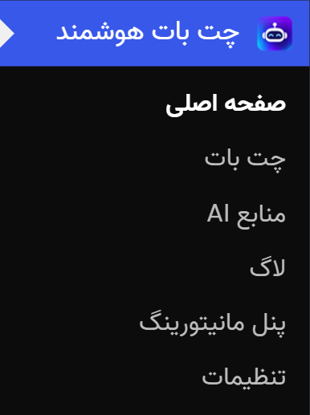
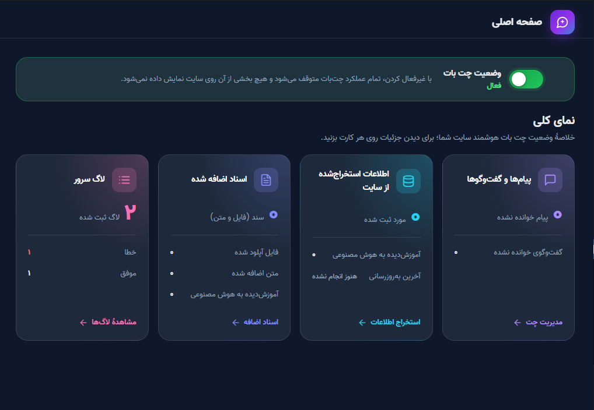
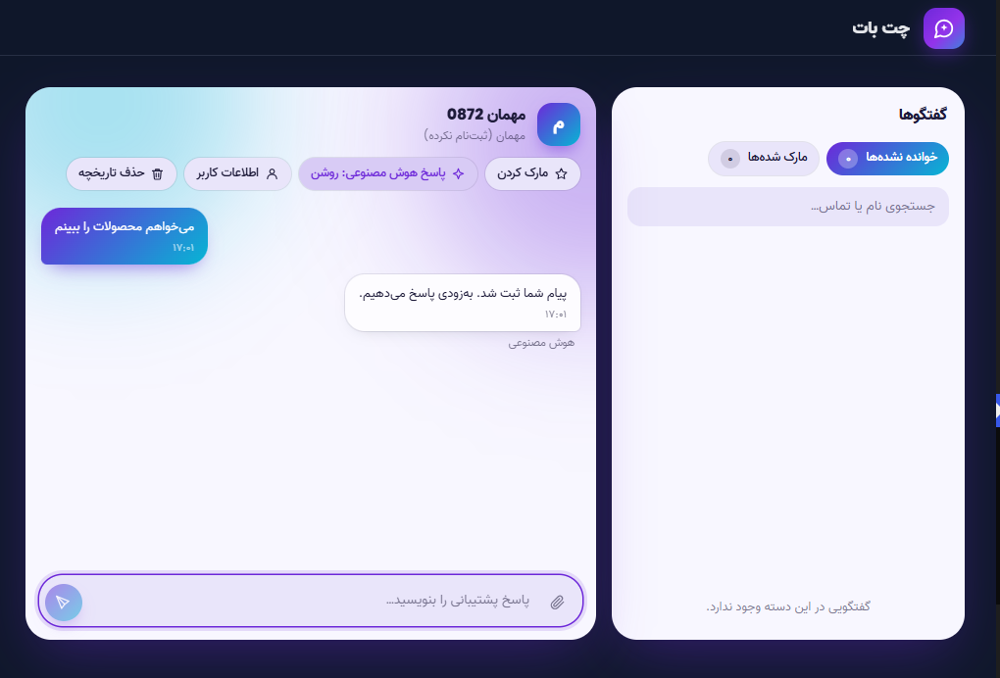
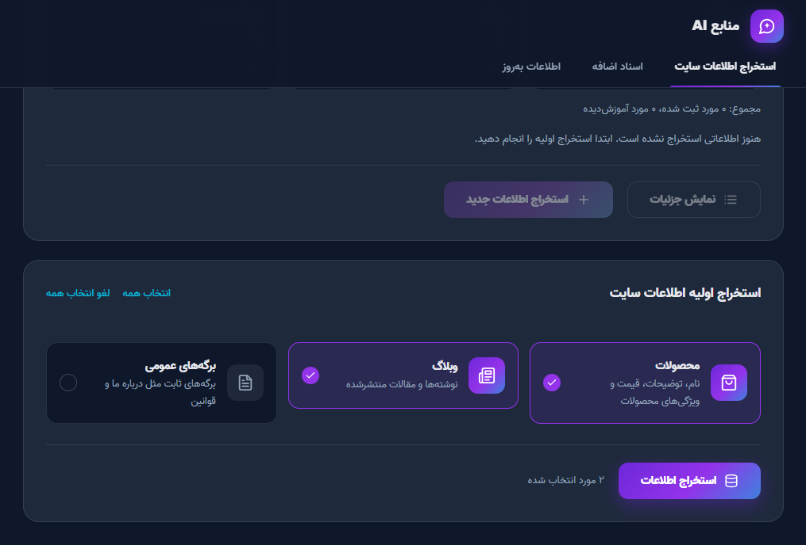
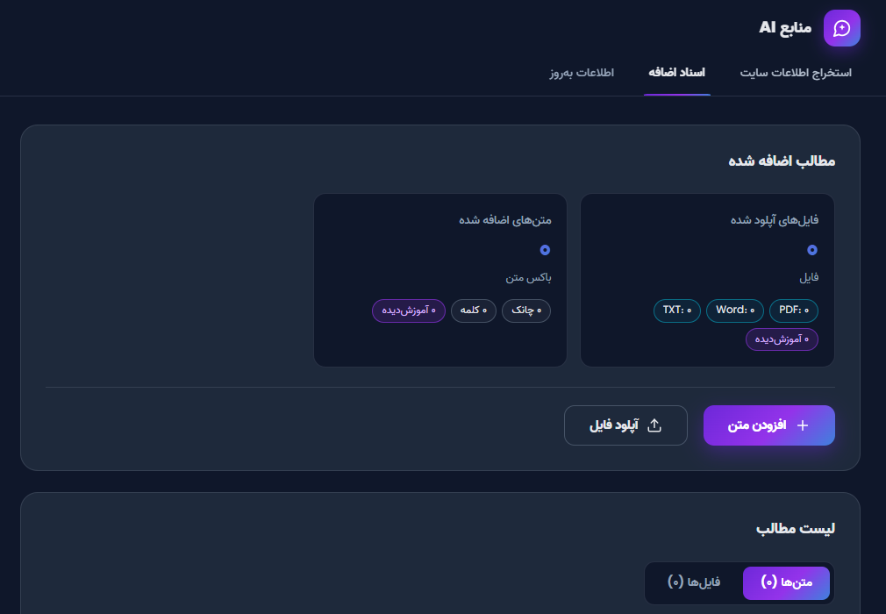
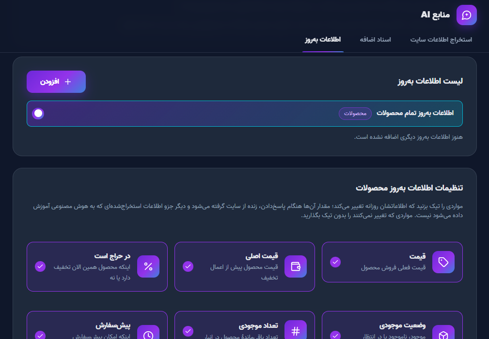
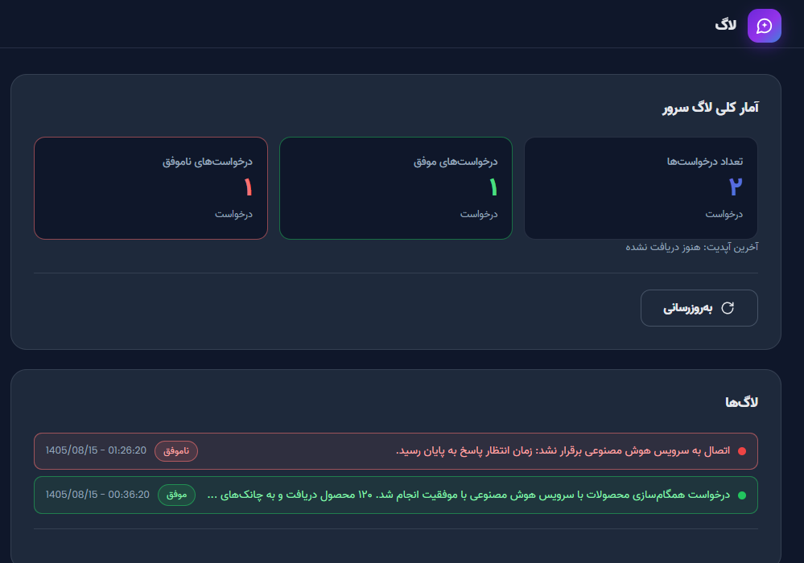
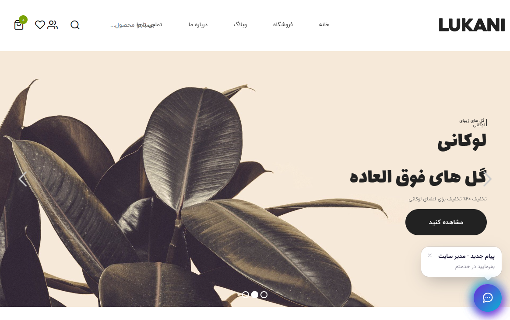
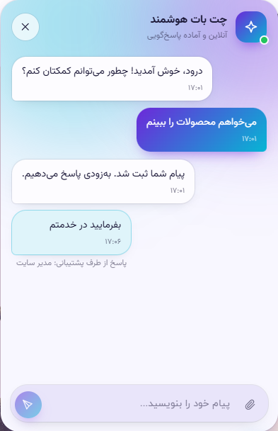

#  آموزش امکانات افزونه Persian Chatbot

این راهنما صفحه‌های افزونه را به ترتیب منوی وردپرس توضیح می‌دهد. برای نصب و اتصال به سرور به [INSTALL.md](../INSTALL.md) مراجعه کنید.

**فهرست:**
[منوی افزونه](#منوی-افزونه) ·
[صفحه اصلی](#صفحه-اصلی) ·
[چت بات (مدیریت چت)](#چت-بات-مدیریت-چت) ·
[منابع AI](#منابع-ai) ·
[لاگ](#لاگ) ·
[پنل مانیتورینگ](#پنل-مانیتورینگ) ·
[تنظیمات](#تنظیمات) ·
[ظاهر چت در سایت](#ظاهر-چت-در-سایت)

---

## منوی افزونه

| زیرمنو | کاربرد |
|---|---|
| صفحه اصلی | روشن/خاموش‌کردن چت‌بات و آمار کلی |
| چت بات | مشاهده و پاسخ به گفتگوهای بازدیدکننده‌ها |
| منابع AI | آموزش اطلاعات سایت، اسناد و اطلاعات به‌روز به هوش مصنوعی |
| لاگ | لاگ ارتباط با سرور هوش مصنوعی |
| پنل مانیتورینگ | گزارش کامل عملکرد سرور (روزانه، ماهانه، سالانه) |
| تنظیمات | همهٔ تنظیمات افزونه |

- کنار منو تعداد **پیام‌های خوانده‌نشده** نمایش داده می‌شود.
- وقتی چت‌بات **غیرفعال** است، صفحه اصلی و پنل مانیتورینگ باز می‌مانند و محتوای بقیهٔ صفحه‌ها قفل می‌شود.

---

## صفحه اصلی

- **کلید وضعیت چت‌بات:** با غیرفعال‌کردن، تمام عملکرد چت‌بات متوقف می‌شود و هیچ بخشی از آن روی سایت نمایش داده نمی‌شود.
- **چهار کارت آمار** (با کلیک روی هر کارت به بخش مربوط می‌روید):

| کارت | چه چیزی نشان می‌دهد |
|---|---|
| پیام‌ها و گفت‌وگوها | تعداد پیام و گفت‌وگوی خوانده‌نشده |
| اطلاعات استخراج‌شده از سایت | تعداد موارد ثبت‌شده، تعداد آموزش‌دیده‌ها، تاریخ آخرین به‌روزرسانی |
| اسناد اضافه‌شده | تعداد اسناد، فایل‌ها، متن‌ها و فرمت فایل‌ها |
| لاگ سرور | تعداد لاگ‌های ثبت‌شده |

---

## چت بات (مدیریت چت)

**فهرست گفتگوها (سمت راست)**
- ترتیب: خوانده‌نشده، سپس مارک‌شده، سپس بر اساس تاریخ.
- فیلتر **خوانده‌نشده** و **مارک‌شده** در بالای فهرست (بعد از رفرش هم حفظ می‌شود).
- نشان تب: دایرهٔ قرمز = گفتگوی خوانده‌نشده، دایرهٔ زرد = گفتگوی مارک‌شده.

**پنجرهٔ گفتگو**
- ظاهر آن همان چت سایت است؛ پیام‌ها به‌صورت لحظه‌ای به‌روز می‌شوند.
- پشتیبان می‌تواند **متن، عکس و ویس** بفرستد. نام حساب وردپرس پشتیبان زیر پیام او نمایش داده می‌شود.
- نشانگر «در حال تایپ» برای هر دو طرف.
- زیر پاسخ هوش مصنوعی، **کارت لینک** محصول، مقاله یا صفحهٔ مرتبط نمایش داده می‌شود.

**ابزارهای هر گفتگو**
- **مارک‌کردن** گفتگو (برای پیگیری بعدی).
- **خاموش‌کردن پاسخ هوش مصنوعی** برای همان گفتگو؛ وقتی پشتیبان وارد می‌شود، هوش مصنوعی پاسخ نمی‌دهد.
- حذف پیام‌های ارسالیِ خود پشتیبان.
- پاک‌کردن کل تاریخچهٔ گفتگو.

**مارک خودکار توسط هوش مصنوعی:** اگر در تنظیمات فعال باشد و هوش مصنوعی نتواند به سؤالی جواب دهد، چیزی برای کاربر ارسال نمی‌کند و فقط گفتگو را مارک می‌کند تا پشتیبان پاسخ دهد.

---

## منابع AI

این صفحه سه تب دارد؛ هر چه در این‌جا «آموزش» داده شود، هوش مصنوعی هنگام پاسخ‌گویی از آن استفاده می‌کند.

### ۱) استخراج اطلاعات سایت

**منابع قابل استخراج:** محصولات (نام، توضیحات، قیمت، ویژگی‌ها) · وبلاگ (نوشته‌ها) · برگه‌های عمومی (مثل درباره ما و قوانین).

**روند کار**
1. **استخراج اولیه:** منابع را انتخاب و اطلاعات را استخراج کنید (فقط وقتی نمایش داده می‌شود که هنوز چیزی ثبت نشده باشد).
2. نتیجه به‌صورت **درخت تیک‌دار** نمایش داده می‌شود؛ مواردی را که می‌خواهید انتخاب و روی **آموزش هوش مصنوعی** بزنید.
3. بعداً با **استخراج اطلاعات جدید** فقط مواردی که قبلاً ثبت نشده‌اند پیدا می‌شوند.
4. استخراج به‌صورت دسته‌ای انجام می‌شود، پس روی سایت‌های بزرگ هم دچار timeout نمی‌شود.

**ثبت خودکار**
- محتوایی که در سایت منتشر یا ویرایش می‌شود، خودکار در فهرست ثبت می‌شود (در بخش «اطلاعات جدید ثبت‌شده به صورت خودکار»). می‌توانید همه را «دیده‌شد» کنید یا آموزش بدهید.
- **موارد حذف‌شده از سایت** جدا نمایش داده می‌شوند و با «حذف از هوش مصنوعی» از دانش آن هم پاک می‌شوند.
- با **نمایش جزئیات** هر مورد را کامل می‌بینید: عنوان، لینک، متن پاک‌سازی‌شده، سرتیترها، دسته‌ها و برچسب‌ها، تصاویر، سئو، فیلدهای سفارشی و ...
- اطلاعاتی که زود تغییر می‌کنند (مثل قیمت و موجودی) جزو اطلاعات ثابت ذخیره نمی‌شوند و از تب «اطلاعات به‌روز» زنده خوانده می‌شوند.

### ۲) اسناد اضافه

برای اطلاعاتی که در سایت نیست (قوانین، راهنما، پرسش‌های متداول و ...).

| روش | توضیح |
|---|---|
| **افزودن متن** | متن را بنویسید. موضوع‌های جدا را با دو بار Enter از هم جدا کنید؛ هر بخش یک «چانک» مستقل از دانش است. می‌توانید **ذخیرهٔ پیش‌نویس** بزنید یا مستقیم **آموزش** دهید. |
| **آپلود فایل** | فرمت‌های PDF، DOC، DOCX و TXT (TXT با کدگذاری UTF-8)، حداکثر ۱۰۰ مگابایت. عنوان اختیاری است (پیش‌فرض نام فایل). |

**شرط‌های فایل:**
- متن باید قابل انتخاب باشد؛ فایل اسکن‌شده یا عکس صفحه‌ها خوانده نمی‌شود.
- فایل رمزدار یا قفل‌شده نباشد.
- متن فارسی هنگام کپی‌کردن از فایل باید درست و خوانا باشد.
- تصویر، نمودار و جدولی که به‌صورت عکس است خوانده نمی‌شود؛ اطلاعات مهم را به‌صورت متن بنویسید.

«لیست مطالب» در دو تب **متن‌ها** و **فایل‌ها** هر مورد را نشان می‌دهد و می‌توانید آموزش بدهید یا حذف کنید.

### ۳) اطلاعات به‌روز

برای اطلاعاتی که هر روز تغییر می‌کنند (قیمت، تخفیف، هزینهٔ خدمات، ساعت کاری). این اطلاعات در دانش هوش مصنوعی ذخیره نمی‌شوند، چون زود قدیمی می‌شوند؛ هوش مصنوعی هنگام پاسخ، آن‌ها را زنده از سایت می‌گیرد.

- **سه مورد ثابت:** تمام محصولات، تمام وبلاگ‌ها، تمام برگه‌ها. هر کدام را فعال یا غیرفعال کنید و تعیین کنید کدام فیلدها زنده خوانده شوند (مثل قیمت).
- **افزودن اطلاعات به‌روز:** هر داده‌ای را که می‌خواهید همیشه آخرین مقدارش را بداند خودتان تعریف کنید:
  - **نام** (مثلاً «خدمات نصب کولر»)
  - **توضیح کوتاه:** هوش مصنوعی فقط با خواندن همین توضیح می‌فهمد کِی باید سراغ این داده برود، پس مشخص بنویسید کاربر چه پرسشی بپرسد.
  - **مقدار فعلی داده:** هر زمان تغییر کرد همین‌جا به‌روز کنید.
- هر مورد قابل فعال/غیرفعال‌کردن، ویرایش و حذف است.

---

## لاگ

لاگ ارتباط افزونه با سرور هوش مصنوعی:
- آمار کلی: **تعداد کل، موفق و ناموفق**.
- فهرست لاگ‌ها از تازه‌ترین؛ با «نمایش لاگ‌های بیشتر» قدیمی‌ترها بارگذاری می‌شوند.
- با کلیک روی هر لاگ، متن کامل و جزئیاتش را می‌بینید (برای پیداکردن علت خطا).

---

## پنل مانیتورینگ

گزارش کامل عملکرد سرور هوش مصنوعی. **حتی وقتی چت‌بات خاموش است** هم در دسترس است.

- **بازهٔ گزارش:** روزانه، ماهانه یا سالانه؛ با دکمه‌های بازهٔ قبل/بعد/اکنون و انتخاب **تقویم شمسی یا میلادی**.
- هر بار که صفحه باز شود، گزارش تازه از سرور گرفته می‌شود (دکمهٔ به‌روزرسانی هم دارد).

| بخش | محتوا |
|---|---|
| وضعیت کلی / نمای کلی | سلامت سرور و شاخص‌های اصلی |
| روند در طول بازه | نمودار روند (ساعتی، روزانه یا ماهانه) |
| گفتگو و پاسخ‌ها | پیام‌ها به تفکیک کاربر، هوش مصنوعی و پشتیبان |
| هوش مصنوعی، توکن و هزینه | مصرف توکن و هزینه |
| جست‌وجوی دانش (RAG) | عملکرد جست‌وجو در اطلاعات آموزش‌دیده |
| ابزارهای زنده و API سایت | درخواست‌های اطلاعات به‌روز |
| پایگاه دانش و آموزش | وضعیت آموزش اطلاعات |
| ارسال نتیجه به سایت‌ها | وضعیت ارسال پاسخ‌ها به وردپرس (callback) |
| درخواست‌های API و امنیت | درخواست‌ها و احراز هویت‌های ردشده |
| خطاها و هشدارها | خطاهای سرور |
| منابع سرور | صف‌ها و ذخیره‌سازی |

---

## تنظیمات

تنظیمات در سه دسته است. تغییرات با دکمهٔ **ذخیرهٔ تغییرات** اعمال می‌شود.

### عمومی

| تنظیم | توضیح |
|---|---|
| عنوان سایت | پیش‌فرض: عنوان سایت وردپرس |
| توضیح کوتاه سایت | یک خط دربارهٔ فعالیت سایت (حداکثر ۱۶۰ نویسه) |
| سرویس هوش مصنوعی | Chat-GPT-5.4 (فعلاً تنها گزینه) |
| لحن صحبت | رسمی یا دوستانه |
| سقف مصرف روزانه / ماهانه (دلار) | خالی = بدون محدودیت |
| توضیحات مهم | مطالب بسیار مهمی که هوش مصنوعی در هر پاسخ باید بداند (حداکثر ۱۵۰۰ نویسه؛ جمله‌های کوتاه بنویسید تا مصرف توکن بالا نرود) |
| مارک‌کردن چت توسط هوش مصنوعی | اگر جواب ندانست، فقط گفتگو را برای پشتیبان مارک می‌کند |
| اتصال به سرور | آدرس سرور و کلید اتصال. امن‌ترین روش تعریف ثابت‌های `PWC_API_URL` و `PWC_API_SECRET` در `wp-config.php` است؛ در این حالت کلید در دیتابیس ذخیره یا نمایش داده نمی‌شود. |

### استخراج اطلاعات سایت

برای هر دسته (محصولات، وبلاگ، برگه‌ها) تعیین کنید وقتی مطلبی منتشر یا ویرایش شد چه اتفاقی بیفتد:
1. خودکار به فهرست مطالب افزونه اضافه یا به‌روز شود.
2. بلافاصله به هوش مصنوعی آموزش داده شود (فقط وقتی گزینهٔ اول فعال باشد).

### مدیریت چت

| گروه | تنظیمات |
|---|---|
| **نمایش** | نمایش آیکن چت در همهٔ صفحه‌ها، محل آیکن (پایین راست/چپ)، نام دستیار، لوگوی چت |
| **متن‌ها** | تیتر و توضیح بالای آیکن، پیام اول فرم نام و تماس، پیام خوش‌آمدگویی، پیشنهادهای پیش‌فرض پیام (هر خط یک پیشنهاد)، پاسخ پیش‌فرض به پیام اول (مثلاً «ثبت شد») |
| **تأخیر هوش مصنوعی** | تا چند ثانیه بعد از آخرین تایپ کاربر صبر کند و همهٔ پیام‌ها را یک‌جا پاسخ دهد (۰ = بلافاصله) |
| **وضعیت آنلاین** | متن زیر نام دستیار، نمایش آنلاین فقط در ساعت‌های مشخص (بر اساس منطقهٔ زمانی سایت؛ بازهٔ شبانه مثل ۲۲:۰۰ تا ۰۶:۰۰ هم پشتیبانی می‌شود)، متن خارج از ساعت آنلاین |
| **رنگ‌بندی** | تم روشن (رنگ اصلی، تأکیدی، پس‌زمینه، متن، کادر نوشتن) و تم دارک که وقتی صفحهٔ سایت یا دستگاه کاربر تیره باشد خودکار فعال می‌شود |
| **ارسال فایل** | اجازهٔ ارسال عکس، ارسال ویس (نیاز به HTTPS)، حداکثر حجم فایل (۱ تا ۲۰ مگابایت) |
| **بهینه‌سازی** | حالت «پیشرفته» برای هاست‌های قوی (به‌روزرسانی لحظه‌ای) یا «بهینه‌شده» برای هاست‌های ضعیف (فشار کمتر روی سرور؛ پیام‌ها کمی دیرتر نمایش داده می‌شوند) |
| **پیام‌رسانی لحظه‌ای** | روشن/خاموش WebSocket (در حالت خاموش ویجت فقط با polling کار می‌کند) و تنظیم فاصله‌های polling |
| **محدودیت درخواست** | سقف درخواست در دقیقه برای هر بازدیدکننده، سقف توکن WebSocket و سقف گفتگوی جدید در ساعت برای هر IP |

> **نگهداری داده:** پیام‌ها و فایل‌های پیوستِ قدیمی‌تر از ۹۰ روز هر روز خودکار پاک می‌شوند.

---

## ظاهر چت در سایت

آنچه بازدیدکنندهٔ سایت می‌بیند:

- **آیکن چت** پایین سمت راست یا چپ صفحه، با **پیام کوچک بالای آیکن** (تیتر و توضیحی که در تنظیمات می‌نویسید) و نشان پیام جدید.

- نام و لوگوی دستیار و وضعیت **آنلاین/آفلاین** (طبق ساعت‌های تنظیم‌شده).
- پیام خوش‌آمدگویی و پیشنهادهای آمادهٔ پیام.
- بازدیدکننده می‌تواند **متن، عکس و ویس** بفرستد (طبق تنظیمات).
- پاسخ هوش مصنوعی همراه با **کارت لینک** محصول یا مقالهٔ مرتبط.
- پاسخ پشتیبان انسانی با برچسب «پاسخ از طرف پشتیبانی» و نام او دیده می‌شود.
- پاسخ هوش مصنوعی از **صفحه‌ای که بازدیدکننده در آن است** هم خبر دارد.
- تم دارک خودکار و ظاهر کاملاً راست‌چین فارسی.

