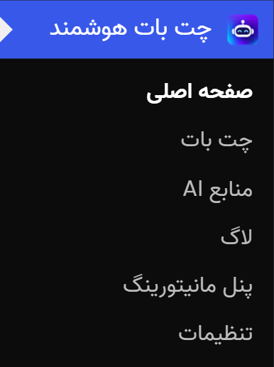
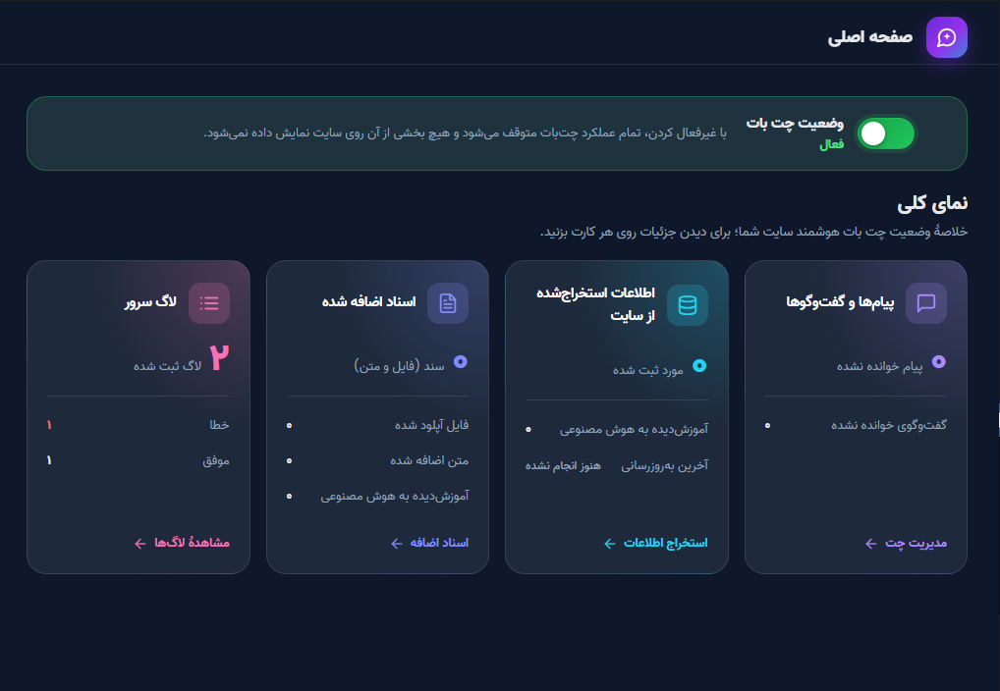
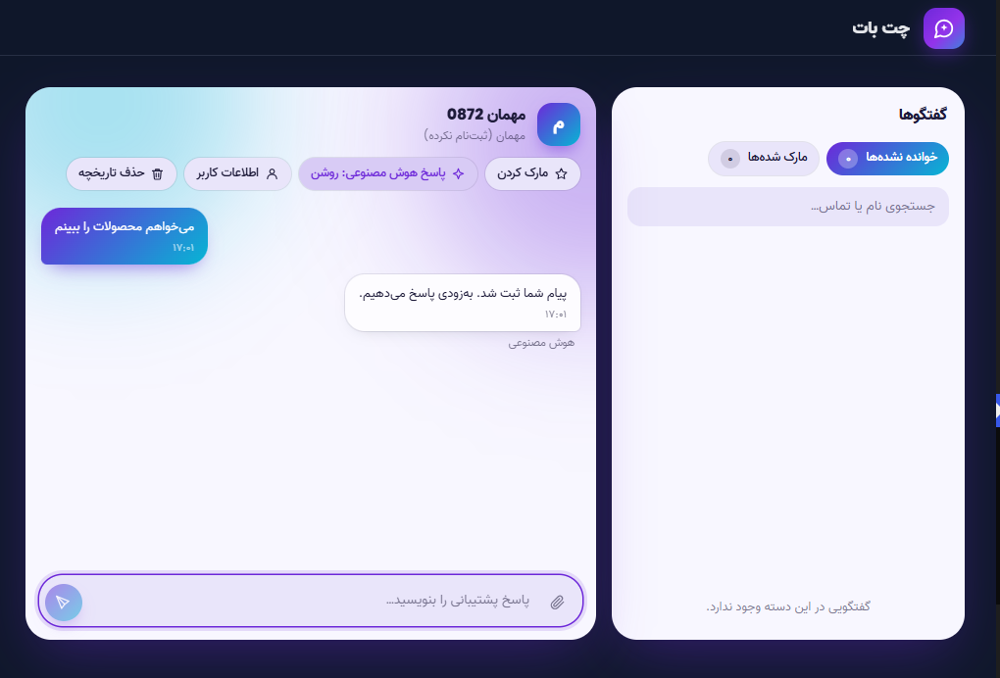
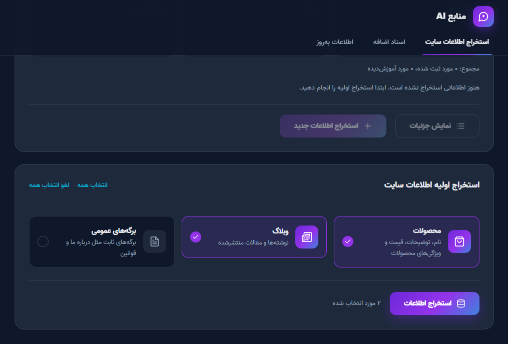
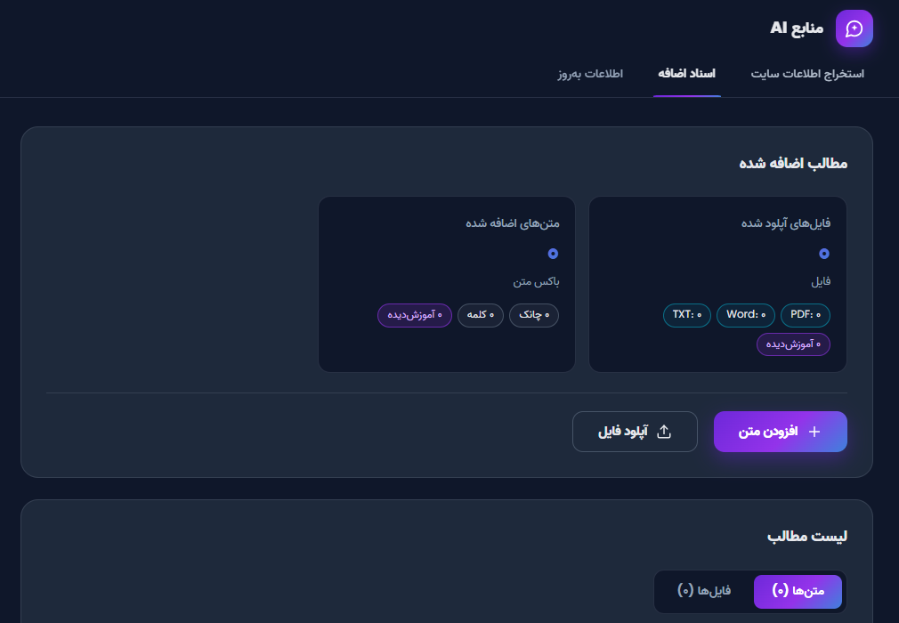
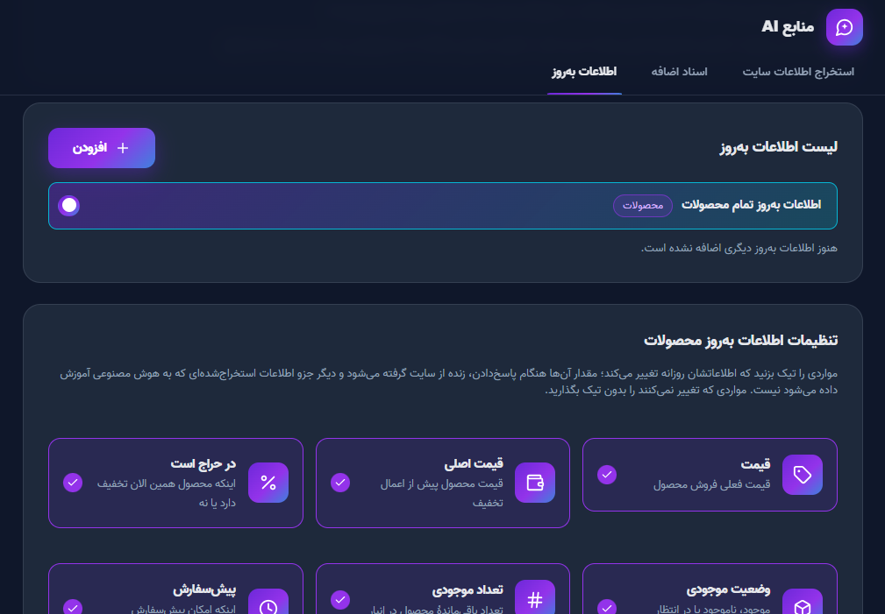
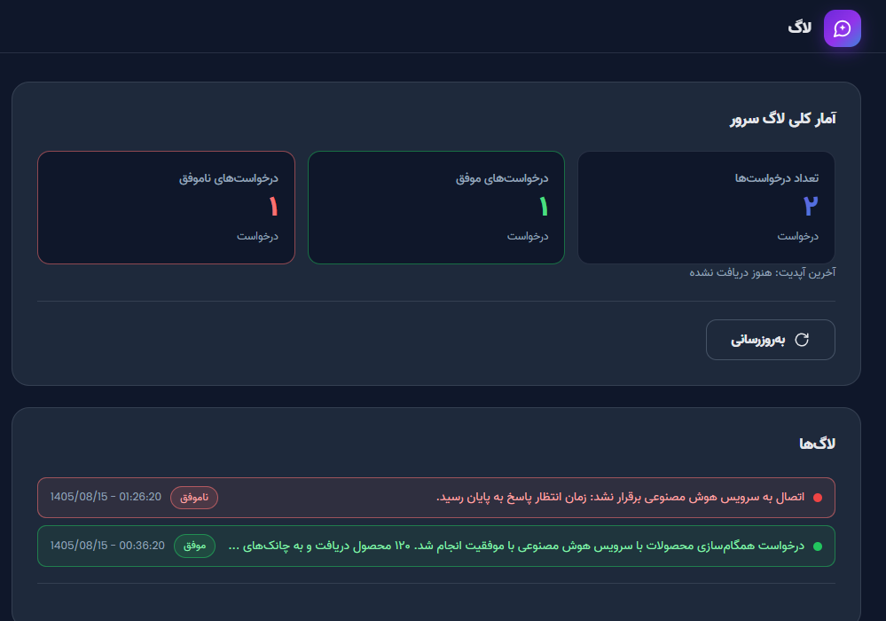
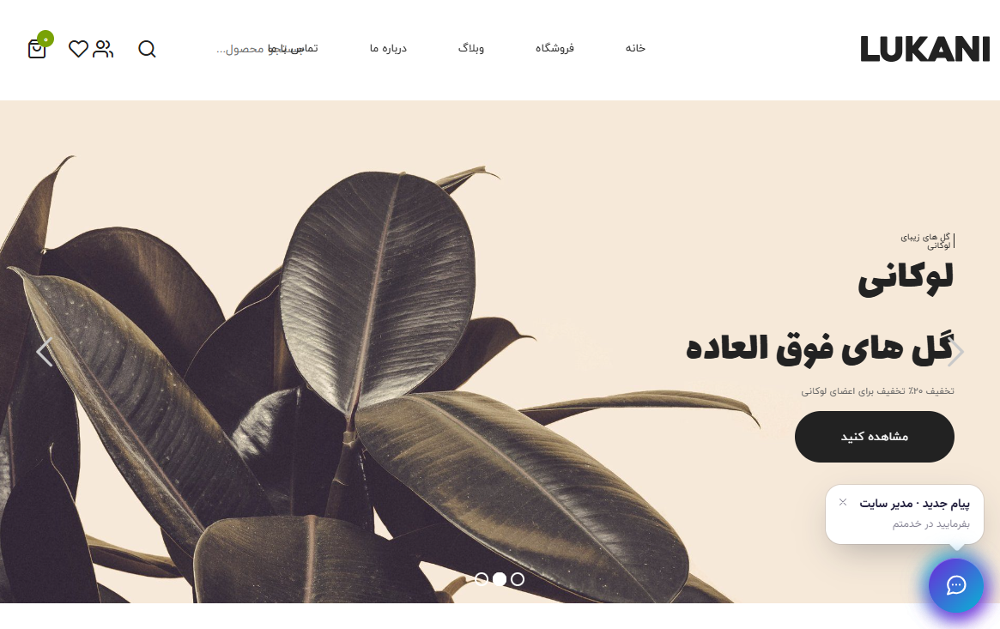
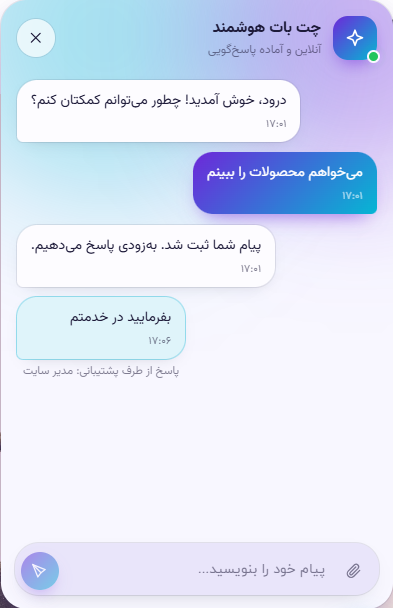

#  Persian Chatbot Plugin Features Guide

This guide explains the plugin's pages in the same order as they appear in the WordPress menu. For installation and server connection instructions, see [INSTALL.md](../INSTALL.md).

**Table of Contents:**

[Plugin Menu](#plugin-menu) ·
[Dashboard](#dashboard) ·
[Chatbot (Chat Management)](#chatbot-chat-management) ·
[AI Sources](#ai-sources) ·
[Logs](#logs) ·
[Monitoring Panel](#monitoring-panel) ·
[Settings](#settings) ·
[Chat Widget on the Website](#chat-widget-on-the-website)

---

## Plugin Menu

| Submenu | Purpose |
|---|---|
| Dashboard | Enable/disable the chatbot and view overall statistics |
| Chatbot | View and respond to visitors' open conversations |
| AI Sources | Train the AI using website content, documents, and up-to-date information |
| Logs | View communication logs between the plugin and the AI server |
| Monitoring Panel | View comprehensive server performance reports (daily, monthly, yearly) |
| Settings | Configure all plugin settings |

- The number of **unread messages** is displayed next to the menu.
- When the chatbot is **disabled**, the Dashboard and Monitoring Panel remain accessible, while the content of all other pages is locked.

---

## Dashboard

- **Chatbot Status Toggle:** Disabling the chatbot stops all chatbot functionality, and none of its components will be displayed on the website.
- **Four Statistics Cards** (clicking any card takes you to the corresponding section):

| Card | What It Shows |
|---|---|
| Messages and Conversations | Number of unread messages and conversations |
| Extracted Website Information | Number of registered items, trained items, and last update date |
| Added Documents | Number of documents, files, text entries, and file formats |
| Server Logs | Number of recorded log entries |

---

## Chatbot (Chat Management)

**Conversation List (Right Side)**

- Sorting order: unread conversations first, then marked conversations, followed by date.
- **Unread** and **Marked** filters are available at the top of the list. Their states are preserved even after refreshing the page.
- Tab indicators: a red dot = unread conversation; a yellow dot = marked conversation.

**Conversation Window**

- Its appearance matches the chat widget on the website; messages are updated in real time.
- Support agents can send **text, images, and voice messages**. The WordPress account name of the support agent is displayed below their messages.
- Typing indicators are available for both parties.
- A **link card** for a relevant product, article, or page is displayed below AI responses.

**Conversation Tools**

- **Mark** a conversation for future follow-up.
- **Disable AI Responses** for a specific conversation. Once a support agent joins, the AI will stop responding.
- Delete messages sent by the support agent.
- Clear the entire conversation history.

**Automatic Marking by AI:**

If enabled in Settings, when the AI cannot answer a question, it will not send any response to the visitor. Instead, it will simply mark the conversation so that a support agent can handle it.

---

## AI Sources

This page contains three tabs. Any information trained here will be used by the AI when generating responses.

### 1. Website Information Extraction

**Extractable Sources:** Products (names, descriptions, prices, attributes) · Blog (posts) · Public Pages (such as About Us and Terms and Conditions).

**Workflow**

1. **Initial Extraction:** Select the sources and extract their information. This option is only displayed when no information has been registered yet.
2. The results are displayed as a **checkable tree**. Select the items you want and click **Train AI**.
3. Later, use **Extract New Information** to find only items that have not been registered before.
4. Extraction is performed in batches, preventing timeouts even on large websites.

**Automatic Registration**

- Content published or edited on the website is automatically added to the list (under the **Automatically Registered New Information** section). You can mark all items as "Viewed" or train them.
- **Items deleted from the website** are displayed separately. Use **Remove from AI** to delete them from the AI's knowledge base as well.
- Click **View Details** to see the complete information for each item, including its title, URL, cleaned text, headings, categories, tags, images, SEO data, custom fields, and more.
- Frequently changing information (such as prices and stock availability) is not stored as static knowledge. It is retrieved live from the **Up-to-Date Information** tab instead.

### 2. Additional Documents

Designed for information that is not available on the website, such as policies, guides, FAQs, and more.

| Method | Description |
|---|---|
| **Add Text** | Write your text directly. Separate different topics with two consecutive Enter presses; each section becomes an independent knowledge chunk. You can click **Save Draft** or **Train** immediately. |
| **Upload File** | Supported formats: PDF, DOC, DOCX, and TXT (TXT files must use UTF-8 encoding). Maximum file size: 100 MB. The title is optional and defaults to the file name. |

**File Requirements**

- Text must be selectable. Scanned documents and page images cannot be read.
- Files must not be password-protected or locked.
- Persian text must remain readable and correctly formatted when copied from the file.
- Images, charts, and tables embedded as images cannot be read. Write important information as text instead.

The **Content List** displays each item in two separate tabs: **Texts** and **Files**. You can train or delete any item.

### 3. Up-to-Date Information

Designed for information that changes frequently, such as prices, discounts, service fees, and business hours.

This information is not stored in the AI's knowledge base because it can quickly become outdated. Instead, the AI retrieves it directly from the website in real time whenever it generates a response.

- **Three Built-in Sources:** All Products, All Blog Posts, and All Pages. You can enable or disable each source and specify which fields should be retrieved live (such as product prices).
- **Add Up-to-Date Information:** You can define any data that you want the AI to always retrieve in its latest form:
  - **Name:** For example, "Air Conditioner Installation Services".
  - **Short Description:** The AI uses this description to understand when it should retrieve this information. Clearly specify what kind of question a visitor might ask to trigger the retrieval.
  - **Current Data Value:** Update this field whenever the information changes.
- Each item can be enabled, disabled, edited, or deleted.

---

## Logs

Displays communication logs between the plugin and the AI server.

- Overall statistics: **Total, Successful, and Failed** log entries.
- Logs are listed from newest to oldest. Click **Load More Logs** to load older entries.
- Click any log entry to view its full content and details, helping you identify the cause of errors.

---

## Monitoring Panel

Provides comprehensive reports on AI server performance. **This panel remains accessible even when the chatbot is disabled.**

- **Reporting Period:** Daily, monthly, or yearly. Navigate using the previous, next, and current period buttons. You can also choose between the **Persian (Jalali) and Gregorian calendars**.
- Every time the page is opened, a fresh report is retrieved from the server. A manual **Refresh** button is also available.

| Section | Content |
|---|---|
| Overall Status / Overview | Server health and key performance indicators |
| Trends Over Time | Performance trend charts (hourly, daily, or monthly) |
| Conversations and Responses | Messages broken down by visitors, AI, and support agents |
| AI, Tokens, and Costs | Token consumption and costs |
| Knowledge Search (RAG) | Search performance across trained information |
| Live Tools and Website API | Requests for up-to-date information |
| Knowledge Base and Training | Knowledge base and training status |
| Response Delivery to Websites | Status of response delivery to WordPress (callbacks) |
| API Requests and Security | Requests and rejected authentication attempts |
| Errors and Warnings | Server errors |
| Server Resources | Queues and storage |

---

## Settings

Settings are divided into three categories. Changes are applied by clicking **Save Changes**.

### General

| Setting | Description |
|---|---|
| Website Title | Defaults to the WordPress site title |
| Short Website Description | A one-line description of the website's activity (maximum 160 characters) |
| AI Service | Chat-GPT-5.4 (currently the only available option) |
| Conversation Tone | Formal or Friendly |
| Daily / Monthly Usage Limit (USD) | Leave empty for unlimited usage |
| Important Instructions | Critical information the AI must know when generating every response (maximum 1,500 characters; use short sentences to reduce token consumption) |
| AI Conversation Marking | If the AI does not know the answer, it only marks the conversation for a support agent |
| Server Connection | Server URL and connection key. The most secure method is to define the `PWC_API_URL` and `PWC_API_SECRET` constants in `wp-config.php`. In this case, the key is neither stored in the database nor displayed in the plugin. |

### Website Information Extraction

For each content category (Products, Blog Posts, and Pages), specify what should happen when content is published or edited:

1. Automatically add the content to the plugin's content list or update its existing entry.
2. Immediately train the AI using the content (only available when the first option is enabled).

### Chat Management

| Group | Settings |
|---|---|
| **Display** | Show the chat icon on all pages, icon position (bottom-right / bottom-left), assistant name, and chat logo |
| **Texts** | Title and description above the chat icon, initial name and contact form message, welcome message, default message suggestions (one suggestion per line), and default response to the first message (e.g., "Received") |
| **AI Response Delay** | How many seconds the AI should wait after the visitor's last keystroke before responding to all messages at once (0 = immediately) |
| **Online Status** | Text displayed below the assistant's name, scheduled online status (based on the website's timezone; overnight intervals such as 22:00 to 06:00 are supported), and offline message |
| **Color Scheme** | Light theme (primary, accent, background, text, and input field colors) and a Dark theme that activates automatically when the website or visitor's device is using dark mode |
| **File Uploads** | Allow image uploads, allow voice messages (requires HTTPS), and maximum file size (1–20 MB) |
| **Optimization** | **Advanced** mode for powerful hosting environments (real-time updates) or **Optimized** mode for weaker hosting environments (reduced server load; messages may appear with a slight delay) |
| **Real-Time Messaging** | Enable/disable WebSocket (when disabled, the widget uses polling only) and configure polling intervals |
| **Request Limits** | Maximum requests per minute per visitor, WebSocket token limit, and maximum new conversations per hour per IP address |

> **Data Retention:** Messages and attached files older than 90 days are automatically deleted every day.

---

## Chat Widget on the Website

What website visitors see:

- **Chat Icon** displayed at the bottom-right or bottom-left corner of the page, with a **small message above the icon** (the title and description configured in Settings) and a new-message indicator.

- Assistant name and logo, along with **Online/Offline** status (based on the configured schedule).
- Welcome message and predefined message suggestions.
- Visitors can send **text, images, and voice messages** (depending on the configured settings).
- AI responses include a **link card** for a relevant product or article.
- Human support responses are displayed with a **"Reply from Support"** label and the support agent's name.
- The AI is also aware of the **page the visitor is currently viewing**.
- Automatic Dark theme and a fully right-to-left Persian interface.
